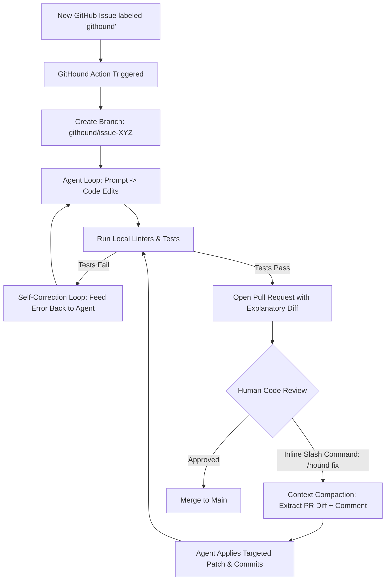

# GitHound 🐾

> **Git-Driven Human-in-the-Loop Harness for Safer Coding Agents**

```
                  __
     (\,--------'()'--o
      (_    ___    /~"
       (_)_)  (_)_)
       [ GitHound ]
```

GitHound is a lightweight TypeScript agent harness that turns Git and GitHub Pull Requests into the ultimate human-in-the-loop (HITL) safety harness for AI coding agents.

Inspired by my dog Harvey, GitHound acts as a vigilant watchdog. Instead of running untethered autonomous agents directly against production or across unmonitored loops, GitHound keeps agents confined to isolated Git branches, enforces deterministic local test gates before opening PRs, and allows engineers to guide revisions using inline `/hound` PR comments.

<p align="center">
  
  <br>
  <em>Here is Harvey in the wilderness helping your Git workflows.</em>
</p>

---

## 💡 The Core Thesis

**We don't need to invent new human-in-the-loop interfaces for AI agents. Git and GitHub Pull Requests are already the ultimate safety harness:**

- **Branches as Blast-Radius Isolation**: Agents work strictly on isolated branches (`githound/issue-123`). If an agent gets confused or hallucinates, `main` remains untouched.
- **Commits as Atomic State Checkpoints**: Every milestone is an atomic commit. You can `git bisect`, `git diff`, or `git revert` agent contributions just like human code.
- **Pull Request Diffs as the Human Review Gate**: Review code side-by-side with familiar GitHub diffs and review threads.
- **CI/CD Pipelines as Automated Oracles**: Before humans spend review time, local linters, typecheckers, and test suites must pass. If tests fail, GitHound feeds terminal errors back into the model for self-correction.

---

## 🏛️ Architecture



### The Three Operational Phases

1. **Intake & Scaffolding**: When an issue is labeled `githound`, GitHound creates an isolated branch, analyzes the issue description, and generates initial code and unit tests.
2. **Deterministic Verification Gate**: Before opening a PR or pushing revisions, GitHound executes your project's local verification commands (`npm run typecheck`, `npm test`). If checks fail, it feeds errors back to Gemini (up to 3 retries).
3. **Interactive PR Steering**: Once the PR is open, developers can highlight code lines and comment `/hound <instructions>`. GitHound compacts context down to the active diff and the surrounding 20 lines, applies targeted updates, re-verifies, and pushes a new commit.

---

## 🚀 Getting Started

### 1. Installation

Clone and install dependencies:

```bash
git clone https://github.com/andrewevans0102/githound.git
cd githound
npm install
```

### 2. Environment Variables

Create a `.env` file (see `.env.example`):

```bash
GITHUB_TOKEN=ghp_your_github_token
GEMINI_API_KEY=your_gemini_api_key
GITHUB_REPOSITORY=owner/repo

# Optional overrides:
GITHOUND_MAX_RETRIES=3
GITHOUND_TEST_CMD=npm test
GITHOUND_TYPECHECK_CMD=npm run typecheck
GITHOUND_MODEL=gemini-2.5-flash
```

### 3. GitHub Actions Workflow

Add `.github/workflows/githound.yml` to your repository:

```yaml
name: GitHound HITL Loop

on:
  issues:
    types: [labeled]
  issue_comment:
    types: [created]
  pull_request_review_comment:
    types: [created]

permissions:
  contents: write
  pull-requests: write
  issues: write

jobs:
  hound:
    if: >
      (github.actor == github.repository_owner || github.event.sender.author_association == 'OWNER') && (
        (github.event_name == 'issues' && github.event.label.name == 'githound' && (github.event.issue.user.login == github.repository_owner || github.event.issue.author_association == 'OWNER')) ||
        (github.event_name == 'issue_comment' && startsWith(github.event.comment.body, '/hound')) ||
        (github.event_name == 'pull_request_review_comment' && startsWith(github.event.comment.body, '/hound'))
      )
    runs-on: ubuntu-latest
    steps:
      - name: Checkout Repository
        uses: actions/checkout@v4
        with:
          fetch-depth: 0

      - name: Set up Node.js
        uses: actions/setup-node@v4
        with:
          node-version: 22
          cache: 'npm'

      - name: Install Dependencies
        run: npm ci

      - name: Run GitHound Dispatcher
        run: npx tsx ./src/index.ts action
        env:
          GITHUB_TOKEN: ${{ secrets.GITHUB_TOKEN }}
          GEMINI_API_KEY: ${{ secrets.GEMINI_API_KEY }}
```

---

## 💬 Interactive Review Commands

When reviewing a PR opened by GitHound, leave a comment starting with `/hound`:

- `/hound add test coverage for empty input arrays`
- `/hound rewrite this loop to use Array.prototype.reduce`
- `/hound handle null and undefined gracefully`

GitHound responds with an eyes emoji (`👀`), analyzes the targeted diff, applies code changes, ensures the verification suite passes, and pushes a new commit to the PR branch.

---

## 🛠️ Local CLI Usage

GitHound includes a CLI for local dry runs, testing, and CI verification:

```bash
# Run verification gate locally
npm run verify

# Trigger issue workflow manually
npx tsx src/index.ts handle-issue --number 42 --title "Add slugify utility" --body "Please create slugify helper"

# Trigger PR revision manually
npx tsx src/index.ts handle-review --pr 101 --comment "/hound optimize performance" --file src/slugify.ts --line 15
```

### Development Scripts

```bash
npm run typecheck    # Run TypeScript typechecker
npm test             # Run Vitest test suite
npm run build        # Compile to dist/
```

---

## 🏢 Team Adoption & Setup Guide

### Is GitHound a Model?
No. GitHound is an **agent harness and workflow orchestration framework**, not an LLM. Google Gemini (or any pluggable model) handles reasoning and code generation, while GitHound acts as the watchdog—enforcing branch isolation, test verification gates, context compaction, and GitHub PR review integration.

### How Teams Can Adopt This Workflow

Teams can adopt GitHound in their own projects in two ways:

#### Option 1: Drop GitHound into Your Existing Repository

GitHound can be added directly to any repository as a GitHub Action without having to install dependencies or copy any source code. It is language-agnostic at runtime—it simply invokes your repo's configured test and typecheck commands. Whether your project is TypeScript, Python, Go, or Rust:

1. **Add Secrets**:
   - Add `GEMINI_API_KEY` to your GitHub repository secrets (Settings > Secrets and variables > Actions).
   - Ensure GitHub Actions has `Read and write permissions` under **Settings > Actions > General > Workflow permissions**.

2. **Add Workflow (`.github/workflows/githound.yml`)**:
   ```yaml
   name: GitHound HITL Loop

   on:
     issues:
       types: [labeled]
     issue_comment:
       types: [created]
     pull_request_review_comment:
       types: [created]

   permissions:
     contents: write
     pull-requests: write
     issues: write

   jobs:
     hound:
       if: >
         (github.actor == github.repository_owner || github.event.sender.author_association == 'OWNER') && (
           (github.event_name == 'issues' && github.event.label.name == 'githound' && (github.event.issue.user.login == github.repository_owner || github.event.issue.author_association == 'OWNER')) ||
           (github.event_name == 'issue_comment' && startsWith(github.event.comment.body, '/hound')) ||
           (github.event_name == 'pull_request_review_comment' && startsWith(github.event.comment.body, '/hound'))
         )
       runs-on: ubuntu-latest
       steps:
         - name: Checkout Repository
           uses: actions/checkout@v4
           with:
             fetch-depth: 0

         - name: Run GitHound
           uses: andrewevans0102/githound@main
           with:
             gemini-api-key: ${{ secrets.GEMINI_API_KEY }}
             github-token: ${{ secrets.GITHUB_TOKEN }}
             test-cmd: "npm test" # e.g. "pytest", "cargo test", "go test ./..."
             typecheck-cmd: "npm run typecheck" # e.g. "mypy .", "tsc --noEmit"
             max-retries: "3"
   ```

   *(Note: You can also run it via `npx --yes githound action` if preferred once published to npm).*

3. **Triggering Workflows**:
   - Create or label any issue with `githound`. GitHound creates a feature branch, executes the task, tests it, and opens a PR.
   - On the PR, review the diff and use `/hound <instructions>` comments to guide revisions.

#### Option 2: Implementing the Core Guardrails in Your Own Tooling

If your team is designing custom internal agents, adopt GitHound's four core architectural rules:

1. **Branch-Level Blast Radius Isolation**: Never grant coding agents write access to `main`. Require dedicated feature branches (`githound/issue-XYZ`) protected by branch rules.
2. **Deterministic CI Oracle & Self-Correction**: Prevent agents from opening PRs or pushing commits if linters or tests fail. Feed `stderr` output back into the model to attempt self-correction, but cap retries (e.g. 3) to prevent runaway loops.
3. **Context Compaction for Reviews**: Never feed an entire repository into a revision prompt. Provide only the PR diff against `main`, the ~20 lines surrounding the inline comment, and the reviewer's instructions.
4. **Familiar Review Surface (Zero UI Drift)**: Do not build custom web portals or IDE extensions for reviews. Developers already know how to review GitHub Pull Request diffs and comment inline.

---

## 🔒 Security & Owner Privilege Enforcement

When exposing LLM coding agents to GitHub issue and comment triggers, preventing prompt injection, unauthorized code commits, and LLM API cost abuse is paramount. GitHound implements a **defense-in-depth** permission model to ensure only repository owners can trigger workflows or open issues:

1. **Workflow Pre-Filter (`.github/workflows/githound.yml`)**:
   - The GitHub Actions job evaluates `github.actor == github.repository_owner || github.event.sender.author_association == 'OWNER'` before assigning a runner.
   - For issue intake, both the issue author and the user applying the `githound` label must be the repository owner.
   - Unauthorized triggers are skipped immediately, preventing runner minute consumption and protecting GitHub tokens and API keys.

2. **Runtime Code Verification (`src/index.ts`)**:
   - As a fail-safe, GitHound's action dispatcher programmatically validates that the event sender and issue author match the repository owner (`isOwner()`) before invoking the LLM or touching git branches.
   - If an unauthorized user triggers an action invocation, GitHound logs a warning and exits safely.

3. **Issue Guard (`.github/workflows/issue-guard.yml`)**:
   - GitHub does not support disabling issue creation for non-owners while keeping issues enabled for owners. GitHound includes an automated issue guard workflow that detects when an issue is opened by a non-owner, immediately posts an explanatory comment, closes the issue as `not_planned`, and locks the conversation.

---

## 📄 License

MIT © [Andrew Evans](https://github.com/andrewevans0102)
