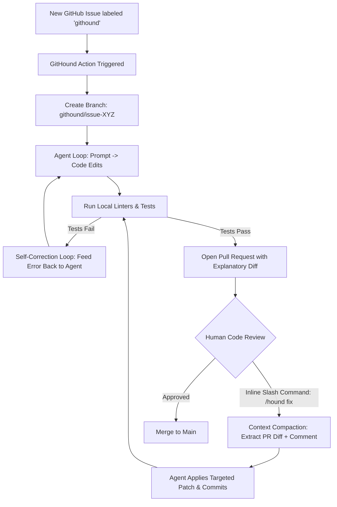

# GitHound 🐾

> **Git-Driven Human-in-the-Loop Harness for Safer Coding Agents**

```
                  __
     (\,--------'()'--o
      (_    ___    /~"
       (_)_)  (_)_)
       [ GitHound ]
```

GitHound is a lightweight TypeScript agent harness that turns Git and GitHub Pull Requests into the ultimate human-in-the-loop (HITL) safety harness for AI coding agents.

Inspired by my dog Harvey, GitHound acts as a vigilant watchdog. Instead of running untethered autonomous agents directly against production or across unmonitored loops, GitHound keeps agents confined to isolated Git branches, enforces deterministic local test gates before opening PRs, and allows engineers to guide revisions using inline `/hound` PR comments.

<p align="center">
  
  <br>
  <em>Here is Harvey in the wilderness helping your Git workflows.</em>
</p>

---

## 💡 The Core Thesis

**We don't need to invent new human-in-the-loop interfaces for AI agents. Git and GitHub Pull Requests are already the ultimate safety harness:**

- **Branches as Blast-Radius Isolation**: Agents work strictly on isolated branches (`githound/issue-123`). If an agent gets confused or hallucinates, `main` remains untouched.
- **Commits as Atomic State Checkpoints**: Every milestone is an atomic commit. You can `git bisect`, `git diff`, or `git revert` agent contributions just like human code.
- **Pull Request Diffs as the Human Review Gate**: Review code side-by-side with familiar GitHub diffs and review threads.
- **CI/CD Pipelines as Automated Oracles**: Before humans spend review time, local linters, typecheckers, and test suites must pass. If tests fail, GitHound feeds terminal errors back into the model for self-correction.

---

## 🏛️ Architecture



### The Three Operational Phases

1. **Intake & Scaffolding**: When an issue is labeled `githound`, GitHound creates an isolated branch, analyzes the issue description, and generates initial code and unit tests.
2. **Deterministic Verification Gate**: Before opening a PR or pushing revisions, GitHound executes your project's local verification commands (`npm run typecheck`, `npm test`). If checks fail, it feeds errors back to Gemini (up to 3 retries).
3. **Interactive PR Steering**: Once the PR is open, developers can highlight code lines and comment `/hound <instructions>`. GitHound compacts context down to the active diff and the surrounding 20 lines, applies targeted updates, re-verifies, and pushes a new commit.

---

## 🚀 Getting Started

### Configure GitHub

1. Add a repository Actions secret named `GEMINI_API_KEY` with your Google Gemini API key.
2. In **Settings → Actions → General → Workflow permissions**, enable read and write permissions and allow GitHub Actions to create pull requests.
3. Create an issue label named `githound`.
4. Add the workflow below as `.github/workflows/githound.yml`. It uses `@v1`, which will be available after the first v1 release. Before then, use a tested full commit SHA to validate the action.

GitHound runs repository-configured test and typecheck commands, sends prompts and relevant code context to Gemini, and can push commits and open pull requests. Review the permissions and owner-only trigger filter below before enabling it. Do not expose the API key or write token to workflows triggered by untrusted users.

```yaml
name: GitHound HITL Loop

on:
  issues:
    types: [opened, labeled]
  issue_comment:
    types: [created]
  pull_request_review_comment:
    types: [created]

permissions: {}

jobs:
  # Optional: close and lock issues opened by non-owners.
  issue-guard:
    if: github.event_name == 'issues' && github.event.action == 'opened' && github.actor != github.repository_owner && github.event.issue.author_association != 'OWNER'
    permissions:
      issues: write
    runs-on: ubuntu-latest
    steps:
      - name: Guard Non-Owner Issue
        uses: andrewevans0102/githound/issue-guard@v1

  hound:
    if: >
      (github.actor == github.repository_owner || github.event.sender.author_association == 'OWNER') && (
        (github.event_name == 'issues' && github.event.action == 'labeled' && github.event.label.name == 'githound' && (github.event.issue.user.login == github.repository_owner || github.event.issue.author_association == 'OWNER')) ||
        (github.event_name == 'issue_comment' && startsWith(github.event.comment.body, '/hound')) ||
        (github.event_name == 'pull_request_review_comment' && startsWith(github.event.comment.body, '/hound'))
      )
    permissions:
      contents: write
      pull-requests: write
      issues: write
    runs-on: ubuntu-latest
    steps:
      - name: Checkout Repository
        uses: actions/checkout@v4
        with:
          fetch-depth: 0

      - name: Run GitHound
        uses: andrewevans0102/githound@v1
        with:
          gemini-api-key: ${{ secrets.GEMINI_API_KEY }}
          test-cmd: "npm test"
          typecheck-cmd: "npm run typecheck"
          max-retries: "3"
          base-branch: "main"
```

The GitHub Actions token is used by default. Set `github-token` explicitly only when you need to provide a different token. For a working end-to-end example—including a small test project—see [githound-doghouse](https://github.com/andrewevans0102/githound-doghouse).

### Action inputs

| Input | Required | Default | Description |
| --- | --- | --- | --- |
| `gemini-api-key` | Yes | — | Google Gemini API key. |
| `github-token` | No | `${{ github.token }}` | Token used for issue and pull request automation. |
| `test-cmd` | No | `npm test` | Repository test command run by the verification gate. |
| `typecheck-cmd` | No | `npm run typecheck` | Repository typecheck command run by the verification gate. |
| `max-retries` | No | `3` | Maximum self-correction attempts after verification fails. |
| `model` | No | `gemini-3.8-flash` | Gemini model name. |
| `base-branch` | No | `main` | Base branch for pull requests and diffs. |

For consumers requiring an immutable dependency, replace `@v1` with the full commit SHA for the release you reviewed.

---

## 💬 Interactive Review Commands

When reviewing a PR opened by GitHound, leave a comment starting with `/hound`:

- `/hound add test coverage for empty input arrays`
- `/hound rewrite this loop to use Array.prototype.reduce`
- `/hound handle null and undefined gracefully`

GitHound responds with an eyes emoji (`👀`), analyzes the targeted diff, applies code changes, ensures the verification suite passes, and pushes a new commit to the PR branch.

---

## 🛠️ Local CLI Usage

GitHound includes a CLI for local dry runs, testing, and CI verification:

```bash
# Run verification gate locally
npm run verify

# Trigger issue workflow manually
npx tsx src/index.ts handle-issue --number 42 --title "Add slugify utility" --body "Please create slugify helper"

# Trigger PR revision manually
npx tsx src/index.ts handle-review --pr 101 --comment "/hound optimize performance" --file src/slugify.ts --line 15
```

### Development Scripts

```bash
npm run typecheck    # Run TypeScript typechecker
npm test             # Run Vitest test suite
npm run build        # Compile to dist/
```

---

## 🏢 Team Adoption & Setup Guide

### Is GitHound a Model?
No. GitHound is an **agent harness and workflow orchestration framework**, not an LLM. Google Gemini (or any pluggable model) handles reasoning and code generation, while GitHound acts as the watchdog—enforcing branch isolation, test verification gates, context compaction, and GitHub PR review integration.

### How Teams Can Adopt This Workflow

Teams can adopt GitHound in their own projects in two ways:

#### Option 1: Use GitHound as an Action

Follow the [GitHub Actions setup](#configure-github) above. GitHound runs the verification commands configured for your repository, so it can be used with projects written in TypeScript, Python, Go, Rust, and other languages. See [githound-doghouse](https://github.com/andrewevans0102/githound-doghouse) for a tested example workflow and test project.

#### Option 2: Implementing the Core Guardrails in Your Own Tooling

If your team is designing custom internal agents, adopt GitHound's four core architectural rules:

1. **Branch-Level Blast Radius Isolation**: Never grant coding agents write access to `main`. Require dedicated feature branches (`githound/issue-XYZ`) protected by branch rules.
2. **Deterministic CI Oracle & Self-Correction**: Prevent agents from opening PRs or pushing commits if linters or tests fail. Feed `stderr` output back into the model to attempt self-correction, but cap retries (e.g. 3) to prevent runaway loops.
3. **Context Compaction for Reviews**: Never feed an entire repository into a revision prompt. Provide only the PR diff against `main`, the ~20 lines surrounding the inline comment, and the reviewer's instructions.
4. **Familiar Review Surface (Zero UI Drift)**: Do not build custom web portals or IDE extensions for reviews. Developers already know how to review GitHub Pull Request diffs and comment inline.

---

## 🔒 Security & Owner Privilege Enforcement

When exposing LLM coding agents to GitHub issue and comment triggers, preventing prompt injection, unauthorized code commits, and LLM API cost abuse is paramount. GitHound implements a **defense-in-depth** permission model to ensure only repository owners can trigger workflows or open issues:

1. **Workflow Pre-Filter (`.github/workflows/githound.yml`)**:
   - The GitHub Actions job evaluates `github.actor == github.repository_owner || github.event.sender.author_association == 'OWNER'` before assigning a runner.
   - For issue intake, both the issue author and the user applying the `githound` label must be the repository owner.
   - Unauthorized triggers are skipped immediately, preventing runner minute consumption and protecting GitHub tokens and API keys.

2. **Runtime Code Verification (`src/index.ts`)**:
   - As a fail-safe, GitHound's action dispatcher programmatically validates that the event sender and issue author match the repository owner (`isOwner()`) before invoking the LLM or touching git branches.
   - If an unauthorized user triggers an action invocation, GitHound logs a warning and exits safely.

3. **Issue Guard Sub-Action (`andrewevans0102/githound/issue-guard@v1`)**:
   - GitHub does not support disabling issue creation for non-owners while keeping issues enabled for owners. GitHound provides a reusable composite sub-action (`issue-guard`) that automatically detects when an issue is opened by a non-owner, posts an explanatory comment, closes the issue as `not_planned`, and locks the conversation without exposing your LLM keys.

---

## 📄 License

Apache-2.0 © [Andrew Evans](https://github.com/andrewevans0102)
